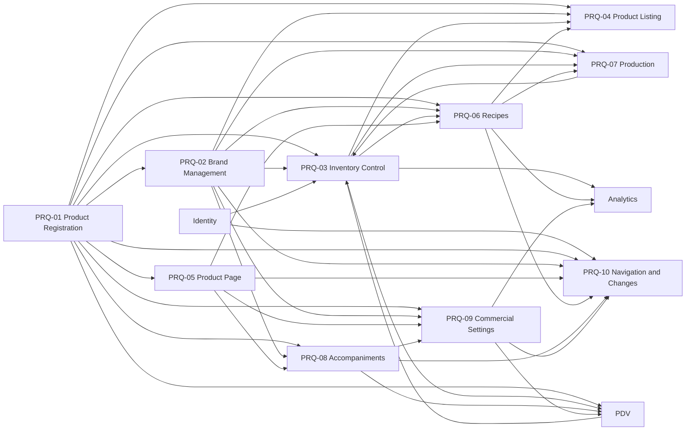

# MRP Product Requirements Document

## 1. Executive Summary

MRP, presented as Scoops Stock, is the operational module for products, categories, brands,
inventory, recipes, production, and accompaniments. It gives Managers a unified view of the
`product → brand → recipe → production → stock` cycle so they can identify constraints before
production, understand current recipe cost, maintain reliable balances, and expose products and
availability to PDV without transferring ownership of MRP rules.

Products, brands, recipes, productions, balances, and stock transactions are isolated by
establishment. Product-dependent quantities inherit the product stock unit; the current approved
experience presents weight quantities in grams.

## 2. Problem and Opportunity

Without an integrated product, recipe, and stock view, ingredient shortages are often discovered
only when production begins. Managers cannot reliably predict how much can be produced, which
ingredient limits output, or the current operating cost of a recipe. Fragmented brand, packaging,
and balance controls also make automatic stock consumption difficult to explain.

The opportunity is to make MRP the authoritative operational source for catalog, stock, recipes,
production, and accompaniments. By recalculating cost and capacity from current product and brand
facts, preserving an immutable movement history, and applying production stock changes atomically,
Scoops can surface constraints before they cause delays or lost sales and provide PDV with stable
product and availability boundaries.

## 3. Target Audience

### Primary audience

- **Manager:** manages products, categories, brands, balances, recipes, production,
  accompaniments, and product-dependent commercial configuration for one establishment.

### Secondary audience

- **Authorized operational user:** consults products, balances, statuses, and stock-movement
  history within the access granted by Identity.
- **Operator:** may use MRP information exposed to permitted operational surfaces, but cannot
  read, preview, or register production in this version.

### Non-audience

- Establishment customers and sales operators performing cart, order, payment, or reconciliation
  work; those experiences belong to PDV.
- Users managing authentication, profiles, plans, subscriptions, financial reporting, or BI;
  those outcomes belong to their owning modules.

### Context, pains, needs, and Jobs to Be Done

- When planning production, I want to see recipe cost, available stock, and the limiting
  ingredient, so that I can decide how much can be produced before work begins.
- When stock changes, I want balances and movement history to remain consistent and attributable,
  so that I can explain the operation later.
- When configuring a product, I want categories, brands, recipes, accompaniments, and commercial
  settings to respect their dependencies, so that the product remains valid for production and
  sale.
- When recording production, I want ingredient consumption and finished-product input to commit
  together, so that a partial failure cannot corrupt inventory.

## 4. Objectives and Success Metrics

- Give Managers pre-production visibility into current recipe cost, producible capacity, and the
  ingredient or brand that limits production.
- Keep product and brand balances synchronized with every committed manual stock transaction and
  production operation.
- Preserve establishment isolation across catalog, inventory, recipes, production, and history.
- Provide PDV with current product, availability, accompaniment, and commercial-configuration
  facts while keeping sales rules in PDV.

Success is measured by:

- every committed manual stock change having one immutable transaction record created atomically
  with its balance change;
- every confirmed production either applying all ingredient write-offs and finished-product input
  or applying none of them;
- no catalog, balance, recipe, production, or transaction fact from another establishment being
  visible or usable;
- every recipe view being able to identify current COGS, maximum producible quantity, and the
  limiting ingredient when ingredients are configured;
- every salable Portion having at least one active size, and products without an active commercial
  configuration remaining unavailable to PDV.

## 5. Requirements

### PRQ-01 — Product Registration and Categories

**Outcome:** Managers can register an establishment-scoped product with valid categories, unit,
stock control, status, and optional operational settings that determine its later MRP behavior.

**Actors:** Manager

**Provides:** Establishment product catalog, category assignments, product stock unit, stock
control, status, ideal-stock target, negative-stock policy, current single-stock ingredient
unit cost, the optional initial Resale and Accompaniment sale prices, and the optional initial
Portion sizes with their sale prices for PRQ-02, PRQ-03,
PRQ-04, PRQ-05, PRQ-06, PRQ-07, PRQ-08, PRQ-09, PRQ-10, and PDV.

#### Capabilities

- A product name is mandatory and unique within its establishment.
- A product owns its stock unit for product-dependent operations. Brands copy that unit when they
  are created, but each brand stores and may configure its own unit independently. Changing the
  product unit never rewrites an existing brand's unit. The model supports `g`, `ml`, `kg`, `l`,
  and `un`; current approved examples and weight experiences use grams.
- Stock control is either `Single stock` or `By brand`; new products default to `Single stock`.
  The selected mode cannot be changed after registration.
- Supported categories are `Ingredient`, `Manufacturable`, `Portion`, `Accompaniment`, and
  `Resale`. `Portion` and `Resale` are mutually exclusive.
- `Manufacturable` enables recipe and production but does not make a product salable by itself.
  `Manufacturable + Portion` is allowed, and a Manufacturable without Portion may be produced
  without appearing in PDV.
- A Portion represents fractional sale of bulk stock and requires at least one active size to
  appear in PDV. An Accompaniment can be linked to a Portion. A Resale represents sale of an
  entire package. `Portion + Accompaniment` is not allowed on product registration or category
  changes; `Accompaniment + Resale` remains allowed.
- An inactive product remains registered but is unavailable to new operations.
- Ideal stock is optional and enables Normal or Low stock classification.
- Internal notes are free text visible only to users authorized by Identity.
- A Single-stock Ingredient may hold a current acquisition cost per base unit. It is optional at
  registration but must exist before the product can be added to a recipe.
- A Manager may define or replace that cost during registration, in product settings, or during
  a positive stock entry. The latest explicit value applies to future recipe and production
  calculations without rewriting historical transactions or productions, and must be at least
  zero. Weighted-average costing is not used in this version.
- A Single-stock product categorized as Resale and/or Accompaniment may receive its sale price
  during registration: a Resale price for Resale and an Accompaniment price for Accompaniment. A
  By-brand product receives no registration sale price, because its Resale prices belong to each
  brand and are set in PRQ-09. A Portion receives no single registration price; it may instead
  receive initial sizes, described below. Each price is optional and follows the PRQ-09 rules;
  a price left empty is not saved, and the product has no commercial configuration for it until
  one is set. A Resale price entered at registration creates the Single-stock Resale
  configuration as available. An Accompaniment price entered at registration becomes the
  Accompaniment's default price defined in PRQ-08 and PRQ-09.
- A Portion may receive zero or more initial sizes during registration. Each size has a Name, a
  quantity in the product stock unit and a sale price, follows the PRQ-09 size rules, and is
  created active. A Portion registered without sizes is saved but does not appear in PDV until an
  active size exists. Any invalid size rejects the whole registration and nothing is saved; the
  product and its sizes are created together or not at all. Registration creates no sizes for a
  product that is not a Portion.
- Products disallow negative stock by default. A Manager may enable `Allow negative stock`, after
  which an initial balance or a write-off may take that product below zero.
- Products and their facts cannot be displayed or used across establishments.

#### Experience

- The registration page contains Name, Unit, Categories, and Stock Control; for a Single-stock
  Ingredient, it may also capture current unit cost. The page is used instead of a modal so the
  manager can review the complete product setup without constrained scrolling.
- For a Single-stock Resale or Accompaniment, the Catalog section, after the Categories,
  also shows `Resale price` or `Accompaniment price`; a product with both categories shows both. The
  fields are hidden for Portion and By-brand products and appear or disappear as the category and
  stock-control selections change, without discarding other entered values. When both are shown,
  each starts empty and is entered independently; registration does not copy or propose the
  Resale price for the Accompaniment price, and later changes to one price never change the other.
- When Portion is selected, a `Sizes and prices` section appears between the Catalog and Stock
  sections. It starts with one empty row and an `Add size` action. Each row captures Name,
  quantity (with the product unit shown) and price, and can be removed; the number of rows is not
  limited. A completely empty row is ignored on submit. A partly filled row requires Name,
  quantity and price, shows its validation beside the field and blocks submission without
  discarding entered values. Size names must be unique within the registration without case
  sensitivity. Rows typed before Portion is unselected are kept, neither validated nor sent, and
  return if Portion is selected again. The section stacks its fields on narrow screens.
- Categories appear as selectable cards with checkboxes and dependency guidance. Selecting
  Portion disables Resale with an explanation, and selecting Resale disables Portion.
- When Manufacturable requires Single stock under the current operating model, selecting it locks
  that control with an explanation.
- Validation appears beside the corresponding field. Successful registration creates an active
  product with zero balance and opens its dedicated page.
- Weight-product quantities are displayed in grams without visually switching between grams and
  kilograms.

---

### PRQ-02 — Brand Management and Main Brand

**Outcome:** Managers can maintain product-specific brands, packaging economics, brand balances,
and exactly one main brand for future automatic write-offs.

**Actors:** Manager

**Consumes:** Product stock control and the product unit default from PRQ-01.

**Provides:** Brand balances, packaging conversion, current unit price, and main-brand selection
for PRQ-03, PRQ-06, PRQ-07, PRQ-08, PRQ-09, and PRQ-10.

#### Capabilities

- Brands exist only for products controlled `By brand` and are not shared between products.
- A brand has Name, Unit, Package quantity, Value per package, and Current stock. Its unit is
  initialized from the parent product when the brand is created, then persists independently.
  Later product-unit changes never rewrite an existing brand unit.
- Package quantity is greater than zero and is expressed in the brand's configured unit. Stock is
  stored in the product stock unit; package entry uses only canonical compatible conversions and
  rejects an incompatible product/brand-unit pair because no user-entered conversion factor is
  supported.
- Managers may enter stock by package or directly by base unit. Unit price equals package value
  divided by package quantity.
- While brands exist, the product has exactly one main brand for automatic write-offs without
  explicit selection. The first brand becomes main automatically. Selecting another brand as main
  atomically unsets the previous main brand, so at most one brand can be main at any time; changing
  the main brand affects only future operations.
- A main brand cannot be deleted while another brand exists until a replacement is selected. The
  final brand may be deleted after warning, leaving the product unavailable until a new main brand
  is added.
- Brand names are unique within the product.
- Deletion requires confirmation and discloses recipes, links, and configurations removed with
  the brand.
- Changes to a main brand's value recalculate COGS for dependent recipes.

#### Experience

- The brand table displays Brand, Packaging, Value per package, Unit price, Stock, and Movements.
- The main brand has a `Main` chip. Each row provides a mutually exclusive main-brand selector and
  actions to edit, select as main, or delete. The UI must never display more than one main-brand
  control as selected for the same product.
- Deletion identifies the brand and known impacts. An empty state offers `Add first brand`.
- The stock-entry modal switches between Packaging and Base Unit and previews package input as
  the converted total in grams for the approved weight experience.

---

### PRQ-03 — Inventory Control and Stock History

**Outcome:** Authorized users can understand current stock and its attributable history, while
Managers can apply valid entries and write-offs without leaving balances and transactions
inconsistent.

**Actors:** Manager, Operator

**Consumes:** Product stock control, unit, ideal-stock target, negative-stock policy, and current
single-stock cost from PRQ-01; brand balances and main-brand facts from PRQ-02; responsible-user
identity and establishment authorization from Identity; production stock changes from PRQ-07;
sales-consumption facts from PDV.

**Provides:** Current product and brand balances, stock status, immutable stock-transaction history
for PRQ-04, PRQ-06, PRQ-07, PDV, and Analytics; authoritative product-total stock-threshold facts for
Communication; and current stock-attention facts for Analytics.

#### Capabilities

- A Single-stock balance belongs to the product; a By-brand total is the sum of brand balances.
- Entry adds a positive quantity and Write-off removes a positive quantity from the selected
  product or brand. Every manual adjustment is classified as one of those operations.
- Quantity is mandatory, greater than zero, and expressed in the product base unit.
- A Manager may provide an optional textual justification for a manual Entry or Write-off. When
  provided, the justification is stored with that stock transaction and shown in its history.
- A positive entry for a Single-stock Ingredient may define the current unit cost from that
  operation onward. A cost change recalculates dependent recipe COGS without rewriting history.
- A write-off cannot produce a negative balance unless `Allow negative stock` is enabled for the
  product.
- Production adds Manufacturable stock after ingredient write-off. PDV owns product,
  accompaniment, and Resale consumption caused by sales.
- Production and other automatic write-offs without explicit brand selection use the main brand.
- Entries and write-offs recalculate total stock, stock status, recipe cost, production status,
  and capacity where applicable.
- After product or brand registration and every committed stock mutation, MRP must classify the
  product-total balance as zero when it is non-positive, below ideal when it is positive and lower
  than a configured ideal-stock target, or normal otherwise. A By-brand product uses the sum of all
  brand balances.
- MRP must publish an authoritative zero-stock or stock-below-ideal fact when product registration
  first establishes either alert state, and whenever a later manual adjustment, brand registration,
  production change, or PDV consumption moves the committed product total into that state. Remaining
  in the same state produces no repeated fact; recovery to another state permits a later threshold
  crossing to publish again.
- Each stock-threshold fact must identify the establishment and product, retain the product name and
  unit at occurrence time, include the resulting available quantity, include the ideal quantity when
  applicable, and distinguish zero stock from stock below ideal. Communication owns recipient and
  message-channel policy and must not recalculate the stock state.
- Every committed manual stock change creates an immutable stock-transaction record in the same
  database transaction as the balance change. This version records manual `Entry` and manual
  `Write-off`; production and PDV own their respective transaction records when implemented.
- Positive initial stock registered with a product or brand creates an Entry; zero creates no
  transaction.
- A transaction retains product, optional brand, unit, quantity, resulting balance,
  optional justification, responsible-user identity, captured display labels, and occurrence time.
  Product, brand, and author labels are snapshots and are not rewritten by later changes or
  deletion.
- Stock-transaction persistence remains local. A committed change that establishes a required stock
  alert state must also initiate its authoritative stock-threshold fact through the transactional
  outbox; the stock transaction itself is not published as a communication event.
- Transactions are isolated by establishment and require the same authorization as their product.
- Operators can read immutable stock history for products they may inspect; stock entry, write-off,
  and all balance-changing actions remain Manager-only.

#### Experience

- The Stock tab displays Current stock, Ideal stock, and Situation. Situation is Normal when
  balance is at least ideal stock, Low when below it, and Normal without target comparison when no
  ideal stock exists. Zero is shown as a valid balance.
- Entry and Write-off actions remain near the relevant balance. A Single-stock Ingredient entry
  may capture current unit cost with its base-unit suffix. Both manual actions expose an optional
  `Justification` field without making submission dependent on it.
- A write-off above the permitted balance blocks confirmation and reports available and requested
  quantities.
- History is newest first, paginated, and filterable by type, brand, and date period. Each row
  identifies the captured author name and initials.
- Author-avatar colors are selected deterministically from the normalized captured name, use an
  accessible semantic color pair, and never replace the visible name.
- Loading, empty, no-filter-results, and error/retry states are distinct and do not hide current
  balance.

---

### PRQ-04 — Product Listing

**Outcome:** Authorized users can find, compare, and open products using establishment-wide
operational context and predictable filters, sorting, and pagination.

**Actors:** Manager, Operator

**Consumes:** Product catalog and classification from PRQ-01; brand totals from PRQ-02; current
balances and stock status from PRQ-03; production capacity from PRQ-06.

#### Capabilities

- Products can be filtered by category, stock status, and product status and searched by name.
- Different filter groups combine with AND; multiple selected categories combine with OR.
- Sorting supports Name, Stock quantity, Number of brands, Categories, and Unit.
- The product list is paginated.
- Operational cards may show Products, Brands, Low Stock, and Products with limited production.
  Their establishment-wide totals do not change with search, filters, sorting, or pagination.
- Low Stock is based on comparison with ideal stock.
- Stock value is not an MRP KPI and belongs to a financial view of costs, profits, and movements.
- Empty results distinguish an establishment with no products from filters with no matches.
- Operators may use the product listing and its filters read-only. Product registration,
  edits, status changes, and product-management shortcuts remain Manager-only.

#### Experience

- The table occupies the available space below the filters. Filters remain in the approved layout
  position without competing horizontally with the table.
- Columns show Name, Stock quantity, Number of brands, Categories, Unit, and necessary actions.
- Operators see product facts and read-only row navigation without product-management actions.
- A Low row may use an alert background, red indicator, and explanatory text without relying on
  color alone.
- Search has an icon and contextual placeholder. `Clear filters` removes every active filter.
- With no products, Managers see `Register first product` and its registration action; Operators see
  an informational empty state without a create action. No filtered matches presents `No products
  found` and `Clear filters` for both profiles.

---

### PRQ-05 — Dedicated Product Page and Settings

**Outcome:** Managers can inspect and maintain each product through one category-aware page, while
Operators can inspect product information without changing it.

**Actors:** Manager, Operator

**Consumes:** Product catalog, categories, unit, status, and stock-control facts from PRQ-01.

**Provides:** Product-page context and recoverable settings-change state for PRQ-06, PRQ-08,
PRQ-09, and PRQ-10.

#### Capabilities

- Stock and Settings tabs are always available. Recipe is available for Manufacturable,
  Accompaniments for Portion, Prices—Sizes for Portion, Prices—Resale for Resale, and
  Portions for an Accompaniment without the Portion category. An Accompaniment-only product
  has no Prices tab.
- Operators can open the product page and read its product, stock, recipe, accompaniment,
  linked Portion, and price information. Every registration, status, stock-policy, and
  destructive action is unavailable to Operators; Manager capabilities remain unchanged.
- PDV consumes size and Resale commercial facts without transferring sales-rule ownership to MRP.
- An Accompaniment product has a default sale price used to start new links and a global
  setting. Each link, and each global setting, carries its own sale price, set or changed through
  the Link or Edit accompaniment dialogs, opened from a Portion or from the Accompaniment
  product's Portions tab, not through a Prices page. These prices are separate from acquisition
  cost and any Resale price, and apply across every size of the linked Portion. Before the first
  save, the dialog proposes the applicable existing Resale price when available; otherwise a
  Manager enters it. Later Resale-price changes do not change a saved Accompaniment price.
- A category in use cannot be removed until its dependencies are resolved.
- Unit changes affect product-owned balances, ideal stock, costs, recipes, sizes, consumption,
  and product-dependent operations and require impact review before confirmation. Existing brand
  units and brand package quantities are not rewritten.
- Every confirmed unit change updates the product unit and causes product-owned quantities and
  costs to adopt the new unit while preserving their existing numeric values exactly. No
  multiplication, division, rounding, density assumption, or conversion factor is applied.
- Unit changes are not blocked because the source and target units belong to different dimensions;
  the product's numeric facts remain unchanged and simply inherit the selected unit.
- Unit relabeling updates only current configuration and balances used by future operations.
  Historical stock transactions, productions, orders, and other retained audit facts keep their
  captured unit, quantity, cost, and labels unchanged.
- Product deletion removes the product and its removable dependent brands, recipe, sizes, links,
  and sales settings after warning and confirmation. Other products remain intact; links to the
  deleted product are removed.

#### Experience

- The header displays Name, Unit, Status, category chips, and stock-control context, plus a
  `Global` tag inside the Accompaniment category chip for a global Accompaniment. The breadcrumb is `Stock > Products > [Product name]`,
  and only category-enabled tabs appear.
- Operators inspect saved Accompaniment prices in linked Portion tables. A product with
  Accompaniment and Resale retains the Resale Prices tab without an Accompaniment price field.
- Settings contains Basic Information, read-only Stock Control with editable negative-stock
  policy, Categories, Internal Notes, and Danger Zone. Product removal is available from the
  Danger Zone rather than from the header.
- Operators see authorized product facts in a read-only presentation. Editable fields, status
  controls, stock-policy controls, creation shortcuts, and the Danger Zone are hidden.
- Unit-change and deletion dialogs explain affected records before confirmation.
- Simple fields may save on blur according to the module design standard.

---

### PRQ-06 — Manufacturable Product Recipes

**Outcome:** Managers can define one recipe for a Manufacturable product and see its current cost,
stock constraints, and maximum producible quantity before recording production.

**Actors:** Manager

**Consumes:** Product categories, units, and single-stock ingredient costs from PRQ-01; main-brand
and brand-price facts from PRQ-02; current balances from PRQ-03; product-page context from PRQ-05.

**Provides:** Persisted recipe, reference yield, current COGS, unit cost, ingredient projections,
limiting-ingredient facts, and maximum producible quantity for PRQ-04, PRQ-07, PRQ-10, PDV, and
Analytics.

#### Capabilities

- Each Manufacturable has at most one recipe in this version. Its reference yield is a positive
  quantity in the Manufacturable product unit.
- A Manufacturable begins without a persisted recipe. Explicitly saving a positive reference
  yield creates the empty recipe; merely opening Recipe writes no data.
- Ingredients cannot be added until the yield is saved. Removing the last ingredient retains the
  recipe and yield.
- Only Ingredient products are eligible recipe lines; an Accompaniment is not a recipe ingredient.
- Each line stores ingredient product, an optional selected brand for By-brand ingredients,
  positive quantity, and the ingredient's inherited unit. Duplicate ingredient combinations are
  not allowed.
- A By-brand ingredient defaults to its current main brand when the line is created or when a
  legacy line has no selected brand. Managers may select another active product-owned brand in
  the recipe editor; the selected brand supplies the line's current cost, capacity, and future
  production consumption. Production is blocked when the selected brand, or the fallback main
  brand, is unavailable.
- Ingredient cost uses current unit price. A Single-stock Ingredient uses its current product unit
  cost and cannot be added while that cost is undefined.
- Total COGS is the sum of line costs for the reference yield. Manufacturable unit cost is
  `Total COGS ÷ Reference Yield`.
- Maximum producible quantity is the lowest ingredient-derived limit.
- Recipe, main-brand, price, cost, or stock changes recalculate COGS and production capacity.
- Removing an ingredient removes only that recipe line.

#### Experience

- The header keeps the editable positive reference yield and Produce action visible.
- The table displays Ingredient, Source/Brand, Quantity, Cost, percentage of COGS, Stock, and
  Movements. Weight quantities and projections use grams in the approved experience.
- A By-brand source shows the selected brand and identifies the main brand when it is the default.
  The recipe editor exposes active product-owned brands when more than one is available and
  defaults to the main brand. Sufficient stock shows balance and estimated capacity; the
  limiting ingredient is highlighted with an alert icon and background.
- An insufficient line reports needed, available, and missing quantities inline.
- `Add ingredient` opens or inserts line configuration. Deletion requires confirmation and
  explains that COGS and capacity will be recalculated.
- The empty state keeps yield controls visible, guides the Manager to save a positive yield and
  add the first ingredient, and disables ingredient creation until the yield persists.

---

### PRQ-07 — Production Record

**Outcome:** Managers can record a Manufacturable production quantity with projected ingredient
consumption and atomic stock updates, while invalid or failed production leaves stock unchanged.

**Actors:** Manager

**Consumes:** Product units and negative-stock policies from PRQ-01; main-brand selection from
PRQ-02; current balances from PRQ-03; recipe, yield, COGS, and ingredient requirements from PRQ-06.

**Provides:** Atomic ingredient write-offs, finished-product input, and retained production facts
for PRQ-03.

#### Capabilities

- Produce is available to a Manager from the recipe or Manufacturable product. Operators cannot
  read, preview, or register production in this version.
- Production can be entered by Batch or Quantity. One batch equals the recipe reference yield;
  quantity uses the product unit, with grams in the approved weight experience.
- Changing batches updates quantity, and changing quantity updates batches when an equivalence
  exists.
- Ingredient consumption is
  `ingredient quantity × (produced quantity ÷ reference yield)`.
- The projection calculates Consumption, Current stock, and After-production stock for each main
  ingredient or brand.
- Insufficient stock blocks confirmation unless the affected ingredient product allows negative
  stock. Consumption applies to the product or main brand according to stock control.
- Produced quantity is added to the Manufacturable balance. Accompaniments are not consumed by
  production.
- Production cost may be calculated from COGS multiplied by batch count; stock value and profit
  remain outside MRP.
- Ingredient write-offs and finished-product input commit in one transaction. Any failure leaves
  all balances unchanged.

#### Experience

- The production modal displays Product, Yield, and a Batch/Quantity switch, with mode and input
  side by side when space allows.
- Batch mode previews the equivalent quantity, such as `Equivalent to 2,000 g`; Quantity mode uses
  the product-unit suffix. Optional shortcuts may include `1 batch`, `2 batches`, and `Maximum`.
- The projection table displays Ingredient/Brand, Consumption, Current, and After.
- An insufficient line is visually distinct and shows needed, available, and missing quantities.
  `Confirm production` is disabled when the applicable negative-stock policy does not permit the
  projected result.
- Success closes the modal, refreshes balances, and confirms production. Failure preserves context,
  states that no changes were applied, and allows retry.

---

### PRQ-08 — Accompaniments and Accompaniment Types

**Outcome:** Managers can maintain establishment-scoped accompaniment types and link eligible
Accompaniment products to Portions, individually or to every Portion at once, with the quantity
and brand context needed for sale.

**Actors:** Manager

**Consumes:** Product categories and units from PRQ-01; main-brand facts from PRQ-02; product-page
context from PRQ-05.

**Provides:** Accompaniment types, Portion-accompaniment links, global accompaniments,
Accompaniment-side management of linked Portions, per-portion consumption, and brand context
for PRQ-09, PRQ-10, and PDV.

#### Capabilities

- A Portion may have zero or more accompaniments, and an Accompaniment may link to multiple
  Portions. New links require an active Accompaniment product without the Portion category. An
  existing retained link remains editable while its active target still has Accompaniment, even if
  its legacy category set also includes Portion; product registration and category changes still
  reject the Portion+Accompaniment combination.
- A Manager can make an Accompaniment global instead of linking it to individual Portions. A
  global Accompaniment applies to every Portion of the establishment, including Portions created
  later, and has one shared type, brand context, quantity per portion and sale price. Changing it from any
  Portion changes it for all Portions. Removing it from a Portion removes it only from that
  Portion, which can be linked to it again later, unless the Manager chooses to remove it from all
  Portions, which also ends its global status. The same eligibility rules as for a link apply.
- An Accompaniment product is either global or linked to individual Portions, never both. Making
  it global replaces its individual links with the global setting. Global status ends only by
  removing it from all Portions, by deleting the product, by removing its Accompaniment category
  when it no longer appears in any Portion, or by making it individual from its `Porções` tab,
  which keeps every Portion that currently has it as an individual link with the same type,
  quantity and price and stops new Portions from receiving it.
- Every product with the Portion category receives the current global Accompaniments, whatever
  its status, including products that gain the category later. Removing the Portion category is
  not blocked by global Accompaniments and stops the product from receiving them.
- Linking a global Accompaniment again to a Portion it was removed from restores it there as the
  same global item without creating a second item, and any shared change applies to all Portions.
- Each link has a contextual type, such as Coverage, Extra, or Free; the same Accompaniment may
  have different types for different Portions.
- Accompaniment types are managed on a dedicated MRP page and are available only within the same
  establishment. Managers can list, create, and rename types.
- An unused type may be removed. A type in use remains protected until its links are resolved;
  renaming updates its existing links.
- Quantity per portion defines consumption for each unit sold; a global Accompaniment consumes
  its shared quantity for each Portion unit sold.
- MRP owns the Accompaniment sale price of each link; PDV uses that link's price for every size
  of the Portion. Each individual link has its own price, so the same Accompaniment may be sold
  at different prices in different Portions, and editing one link's price never changes another
  link. A global Accompaniment has one shared price for all Portions. The Accompaniment product
  keeps a default price, taken at registration or from the first saved link, that only prefills
  new links and global settings and never changes existing ones.
- When accompaniment stock is By brand, consumption uses its current main brand.
- Removing a link does not change current balances and requires confirmation.
- An Accompaniment product without the Portion category manages its Portions from its own
  `Porções` tab. A Manager can link several Portions in one operation with one shared type and
  quantity per portion, and can edit or remove each individually linked Portion on its own.
  Eligible Portions are products with the Portion category, regardless of status, that do not
  already have the Accompaniment. The tab applies the same eligibility, price, global and
  removal rules as the Portion-side dialogs and creates no new kind of link.
- For a global Accompaniment, the tab lists the Portions that currently have it with its shared
  type, quantity and price. A Manager edits those shared values once for all Portions. Removal
  from one Portion or from all Portions follows the global rules above. The tab offers no Link
  action for a global Accompaniment; an excluded Portion is restored from that Portion's own
  Link dialog, as the same global item.
- Operators can read the `Porções` tab and cannot link, edit or remove.

#### Experience

- The link table displays Accompaniment, Type, Brand, Quantity per portion, the product's sale
  price, and Actions. Global Accompaniments appear in every Portion's table with a `Global` badge
  beside the name, and the table description states that global items appear in all Portions.
  `Link accompaniment` opens a modal for Accompaniment, Type, the product's sale price, Quantity
  per portion, applicable Brand, and cost preview.
- The Link and Edit dialogs opened from a Portion include, for an Accompaniment that is not
  global, a `Disponível para todas as porções` switch explaining that the item appears in all
  Portions, including new ones, and that type, quantity and price are shared.
  When the switch is on, the dialog shows a notice that changes apply to all Portions. For an
  individually linked item, turning the switch on in Link or Edit states before saving that its
  individual links in other Portions will be replaced by the global setting.
- Editing a global Accompaniment from a Portion shows no switch; its global notice states that
  changes apply to all Portions and that it stops being global only through `Remover`. No action
  in the Edit dialog ends global status. Dialogs opened from the Accompaniment's `Porções` tab have no `Disponível para
  todas as porções` switch: global status changes only through `Tornar global` and
  `Tornar individual`, and a global item's Edit dialog shows the notice that changes apply to
  all Portions.
- The Link dialog lists only eligible Accompaniment products not already present in the Portion.
  Choosing a global Accompaniment removed from that Portion shows the same global notice, without
  the switch, and the shared values.
- Global Accompaniments are listed before individually linked ones in the Portion table. No
  Portion count appears in the global notice, the table description, or the removal dialogs.
- Removing a global Accompaniment opens a confirmation with a `Remover de todas as porções` switch.
  With the switch off, it removes the item only from the current Portion and states that the other
  and new Portions keep it. With the switch on, it removes the item from all Portions and states
  that new Portions will not receive it. Both states state that stock balances do not change.
- The Link dialog prefills the Accompaniment's default price. If none is saved, it proposes the
  applicable Resale price when available; otherwise the Manager enters a valid price before
  linking. The entered price applies independently to each link created by that save, never to
  existing links. The Edit dialog of an individual link shows and edits only that link's price,
  which applies to every size of that Portion for future sales. Dialogs of a global Accompaniment
  edit its shared price for all Portions. The field uses the rules in PRQ-09, and the cost preview
  remains separate from the sale price.
- The current main brand is visible. The link table displays each link's sale price, which
  applies to every size of that Portion and is managed in Link or Edit accompaniment dialogs.
- The type selector offers `Manage types`, which opens the dedicated `Accompaniment types` page.
- The types page displays registered types, usage status without link counts, and removal only
  for unused types, with `New type` opening creation. Pagination shows visible range, total count,
  previous, next, and numbered-page controls when records exceed one page.
- Editing opens a modal prefilled with the current name. Successful save renames the type across
  links; invalid or duplicate names retain entered context and show validation without closing.
- Creation includes the type name, supporting guidance, `Cancel`, and `Add type`. Success closes
  and refreshes; validation failure preserves entered context.
- `Accompaniment types` is a Manager-only direct page but not a global sidebar destination. The
  Products page links to it contextually, and the link modal retains `Manage types`.
- A shared outlined, accessible `Voltar` link with a left-arrow icon is used on Type and Product
  Details pages. From Types it returns to the previously visited canonical URL state; direct entry
  falls back to Products.
- Unused-type removal uses readable destructive red outline/text styling; in-use removal is
  disabled with readable neutral styling.
- No component requires a Portion to have an accompaniment.
- The `Porções` tab shows a paginated, name-searchable table of the Portions that have the
  Accompaniment, with Portion, Type, Quantity per portion, the product's sale price, and Actions
  for Managers. Each row shows its own link price, as shown in that Portion's accompaniment
  table, and it is changed only in the Link and Edit dialogs; a global shows the same shared
  price on every row.
- `Link Portions` opens a dialog with a searchable multi-select of eligible Portions that shows
  each Portion's status, one shared Type and Quantity per portion, one sale price for the new
  links under the PRQ-09 rules, and the cost preview. It is offered only for an individually
  linked Accompaniment.
- An individually linked Accompaniment has Edit and Remove per row. A global one shows the
  `Global` tag inside its Accompaniment category chip in the page header. Its rows show type and
  quantity read-only with only `Remover desta porção`. The page has one `Editar` action for the
  shared type, quantity and price, and one `Remover de todas as porções` action, with the
  existing confirmations and no Portion counts. A global Accompaniment's tab has no
  `Link Portions` action.
- An individually linked Accompaniment also offers `Tornar global`, which opens the shared type,
  quantity and price with the global notice and, when individual links exist, states that they
  will be replaced by the global setting. A global one also offers
  `Tornar individual`, which asks for confirmation and keeps its current Portions as individual
  links.
- With no linked Portion, an empty state offers `Link Portions`. With no Portion registered, it
  guides the Manager to register one first. Loading, error and retry states are distinct.

---

### PRQ-09 — Integrated Commercial Settings

**Outcome:** Managers can maintain accompaniment, Portion, and Resale prices and availability
that determine future PDV operations without duplicating cart, sale, or historical-order rules in
MRP.

**Actors:** Manager

**Consumes:** Product categories, units, and status from PRQ-01; brand facts from PRQ-02;
product-page context from PRQ-05; accompaniment links from PRQ-08.

**Provides:** Accompaniment link and global sale prices, active Portion sizes and their sale prices,
Resale packaging and brand availability, and current operating-cost facts
for PRQ-10, PDV, and Analytics.

#### Capabilities

- Each Portion size has a Name, quantity in the product stock unit, sale price, and status. Every
  salable Portion has at least one active size.
- Resale configuration has sale price and availability. A Single-stock Resale sells and writes
  off one product stock unit per sale. A By-brand Resale defines price and availability per
  existing brand while inheriting that brand's packaging quantity as read-only commercial
  context; it has no unbranded fallback configuration.
- Each Accompaniment link, and each global Accompaniment, has one required sale price for use as
  an accompaniment, separate from acquisition cost and Resale price. The price is non-negative
  and allows at most two decimal places. A zero price represents a free accompaniment; the
  accompaniment type is descriptive and does not change the price.
- Before an Accompaniment price is first saved, propose the existing Resale price when available:
  use the product's single Resale price for Single stock control, or the current main brand's
  configured Resale price for By-brand stock control. The proposal is not saved automatically. If
  the applicable Resale price is not configured, require the Manager to enter the Accompaniment
  price. After it is saved, the Accompaniment price is independent; later Resale-price changes do
  not update it.
- The Accompaniment product keeps a default price that only prefills new links and global
  settings. It is set at registration or, when still unset, by the first saved link, and no later
  Link or Edit save changes it. A link or global whose price is not configured stays inactive for
  PDV.
- Registration is also a first-save moment for the Accompaniment default price. For a
  Single-stock product with both Resale and Accompaniment categories, the Manager enters each
  price independently; the Resale price typed in the same form is not proposed for or copied into
  the Accompaniment price. If the Accompaniment price is left empty, the Link and Edit dialogs
  later propose the saved Resale price under the rule above. After registration, both prices
  follow the rules above.
- Before an Accompaniment product can be linked to a Portion, a sale price must be set as part of
  the Link action when the default is not already configured.
- Each individual link's sale price applies across every size of its Portion and is independent
  of every other link, even for the same Accompaniment. A global Accompaniment's sale price is one
  shared value for all Portions. Linking the product or adding a Portion size never changes an
  existing link's price. Managers can change a link's price in the Edit accompaniment dialog,
  opened from a Portion or from the Accompaniment product's Portions tab; the change updates only
  that link for future sales, or the shared price for a global Accompaniment.
- Configuration changes affect future PDV behavior and do not rewrite previous orders.
- A size name is trimmed, mandatory, and unique within its product without case sensitivity.
  Quantity is positive with at most three decimal places, and sale price is non-negative with at
  most two decimal places. New sizes are active by default.
- A Manager can edit a size's name, quantity, sale price, and active status from the pricing table.
  Invalid values are rejected, and the final active size cannot be deactivated.
- A size created during product registration (PRQ-01) follows the same rules and is
  indistinguishable from one added here; later edits, activation and removal use this surface.
- Size removal requires confirmation. Removing the final active size is allowed and makes the
  Portion unavailable to future PDV operations until another active size is added; removal does
  not rewrite previous orders.
- Operating cost, profit, and margin remain calculated read-only values when their owning
  financial capability is available. Total stock value, profit, margin reporting, cart behavior,
  sales write-off, and order history are not owned by MRP.

#### Experience

- Prices—Sizes appears for Portion and Prices—Resale for Resale. Accompaniment-only products have
  no Prices tab; Accompaniment+Resale products show only Resale settings there. Accompaniment
  pricing is edited in a linked Portion's Link or Edit accompaniment dialog.
- The size table displays Name, Quantity, Operating Cost, Price, available Profit/Margin values,
  and Movements.
- Link and Edit accompaniment dialogs display and edit the sale price of the link (or of the
  global setting) from either entry point. The Edit dialog prefills the link's saved price; the
  Link dialog prefills the Accompaniment's default and, before it is set, proposes the applicable
  Resale price or requires Manager entry. The Portion Prices—Sizes area displays and edits each
  Portion size's sale price.
- The Accompaniments table displays each link's own sale price. That price applies to every size
  of that Portion and may differ from the same Accompaniment's price in other Portions.
- Sizes and Resale brand configurations can be activated or deactivated without automatically
  deleting configuration. By-brand packaging is displayed from the current brand and is not
  edited in the pricing surface.
- Products without active commercial configuration do not appear in PDV.
- Invalid size edits preserve the editing context and show validation; successful edits refresh
  future commercial availability without changing historical orders.

---

### PRQ-10 — Navigation, States, and High-Impact Changes

**Outcome:** Managers can navigate MRP and complete or recover from destructive and high-impact
product changes with clear dependency, loading, success, and error feedback. Operators can
navigate to Products and inspect product information only.

**Actors:** Manager, Operator

**Consumes:** Establishment authorization from Identity; product and dependency facts from
PRQ-01, PRQ-02, PRQ-05, PRQ-06, PRQ-08, and PRQ-09.

#### Capabilities

- Operators receive only the Products destination from MRP and cannot access MRP administration,
  production, Price Modifiers, or Accompaniment Types. Managers retain the existing MRP navigation
  and contextual Accompaniment Types access.
- MRP navigation provides Products context without unnecessary sub-navigation. Dashboard, PDV,
  Order History, and Price Modifiers remain destinations of their owning product areas;
  Accompaniment Types is reached contextually rather than from the global sidebar.
- Opening a product row or Details action opens its dedicated page.
- Category removal is blocked only by configuration whose validity depends on that category:
  recipes consuming an Ingredient, the owned recipe of a Manufacturable, sizes and accompaniment
  links of a Portion, Portion products using an Accompaniment, and resale configurations of a
  Resale product.
- Products, brands, recipe ingredients, accompaniment links, and sizes require warning and
  confirmation before destructive removal. Danger Zone lists affected records.
- Identity owns authentication, profiles, permissions, and users.
- Unit changes require warning before save. The confirmed product unit changes while product-owned
  current values keep their numeric values unchanged and adopt the new unit; existing brand units
  and package quantities remain independent. No conversion factor is requested or applied.
- Product removal and removable dependent configuration complete atomically. If any dependency
  cannot be removed safely, nothing is deleted and the error identifies a recovery action.
- Product removal does not alter historical orders or retained operational and audit records.

#### Experience

- Breadcrumbs preserve `Stock > Products > Product` context.
- Search, retrieval, calculation, and production show loading feedback. Every table has an empty
  state that guides the next action.
- A unit dialog explains that the product unit affects product-dependent operations while each
  brand keeps its own configured unit.
- Dependency dialogs provide direct actions to the configuration that blocks the category
  removal. Ingredient dependencies open affected recipes; Manufacturable dependencies open its
  Recipe; Accompaniment dependencies open the Accompaniment product's `Porções` tab; a legacy
  product that also has the Portion category opens Products filtered to Portions using that
  accompaniment; Resale dependencies open Prices focused on resale settings; Portion dependencies
  offer separate Prices and Accompaniments actions.
- Closing a dependency dialog changes nothing. Following an action preserves the attempted
  category change so it can be retried after dependencies are resolved.
- Cancelling a unit-change dialog leaves product and dependent quantities unchanged.
- A deletion dialog uses clear destructive language, `Cancel`, and `Remove`, and consolidates all
  dependent records to be removed. Failure preserves all data and provides an actionable error.
- Tables, cards, and modals do not overlap or clip content on smaller screens. Components, tokens,
  icons, focus behavior, and readable state styling follow the design system.

## 6. Product Dependency Graph

An edge points from the provider to the requirement or module that consumes its capability or
authoritative fact.

## 7. User Journeys

### Journey A — Authorized user consults products

1. The user opens `Products`.
2. The system shows establishment-wide operational cards, search, filters, and the paginated
   table.
3. The user filters by category, stock, or status and may sort by Name, Stock quantity, Number of
   brands, Categories, or Unit.
4. The system combines filter groups with AND, selected categories with OR, and leaves KPI totals
   unchanged.
5. The user opens a product's `Details` action.
6. The system opens the dedicated product page on Stock.

### Journey B — Manager registers a product

1. The Manager selects `New Product`.
2. The system presents Name, Unit, Categories, and Stock Control; a Single-stock Ingredient may
   also receive current unit cost, a Single-stock Resale or Accompaniment may also receive its
   optional sale price, and a Portion may also receive its initial sizes and their prices.
3. The Manager completes the fields.
4. The system validates:
   - **Success:** creates an active product with zero balance and opens its page.
   - **Duplicate name:** reports that the name already exists in the establishment.
   - **Missing unit:** requests a unit without discarding entered context.
   - **Missing category:** requests at least one category without discarding entered context.
5. The Manager can then configure brands, recipe, accompaniments, or prices according to category.

### Journey C — Manager manages brands

1. The Manager opens a product controlled By brand and selects `Link brand`.
2. The Manager enters name, package quantity, package value, and initial stock.
3. The system calculates unit price and total stock; the first brand becomes Main.
4. The Manager may switch the main brand for future operations.
5. When deletion is requested, the system shows impacts and requires confirmation.
6. On success, the system recalculates dependent cost and capacity facts.

### Journey D — Manager adjusts stock

1. The Manager opens Stock and chooses Entry or Write-off.
2. For By-brand stock, the Manager selects the relevant brand balance.
3. The Manager selects Packaging or Base Unit, enters a positive quantity, and may replace current
   unit cost for a Single-stock Ingredient entry.
4. The system previews the base-unit total and validates:
   - **Valid Entry:** adds the balance and records the transaction atomically.
   - **Valid Write-off:** subtracts the balance and records the transaction atomically.
   - **Disallowed negative result:** blocks confirmation and reports requested and available
     quantities.
5. The system refreshes balance, history, stock status, recipe cost, and production capacity.

### Journey E — Manager assembles a recipe

1. The Manager opens a Manufacturable product and selects Recipe.
2. The Manager explicitly saves a positive reference yield, creating an empty persisted recipe;
   opening the tab alone writes nothing.
3. After save succeeds, the Manager adds an eligible Ingredient and positive quantity.
4. The system inherits the unit, defaults a By-brand ingredient to its current main brand, and
   allows the Manager to choose another active brand when available.
5. The system calculates line cost, COGS share, balance, limiting ingredient, and capacity.
6. Saving the line updates total COGS and maximum producible quantity.

### Journey F — Manager records production

1. The Manager selects `Produce`.
2. The system opens Batch/Quantity entry with an equivalent-quantity preview and ingredient
   projection.
3. The Manager enters batches or produced quantity.
4. The system validates each projected balance:
   - **Insufficient and negative stock disallowed:** shows needed, available, and missing inline
     and blocks confirmation.
   - **Sufficient or negative stock allowed:** enables confirmation.
5. On confirmation, the system writes off ingredients and adds produced stock atomically.
6. Success closes the modal and refreshes stock. Failure applies no change, preserves context, and
   allows retry.

### Journey G — Manager configures accompaniments

1. The Manager opens a Portion and selects Accompaniments, then `Link accompaniment`.
2. The Manager selects an eligible product, type, quantity per portion, and applicable main brand.
3. The modal shows the Accompaniment's default price. Before it is set, it proposes the applicable
   configured Resale price when available; otherwise the Manager enters the required price. The
   expected cost remains a separate preview.
4. When the link is saved, its price applies to every size of that Portion for future sales. The
   Accompaniments table displays that link's price. The Manager may later edit it through that
   link's Edit accompaniment dialog without changing any other link; later Resale-price changes do
   not change it.
5. PDV uses the link's price regardless of Portion size; a zero price is displayed as `Grátis`,
   and registered orders retain their original prices.

**Alternate path — from the Accompaniment product:**

1. The Manager opens an Accompaniment product and selects `Porções`, then `Link Portions`.
2. The Manager selects Portions, a type and a quantity per portion. The dialog shows the default
   price, proposes the applicable Resale price, or requires the Manager to enter one.
3. When the links are saved, each new link receives that price independently, existing links keep
   theirs, and the table lists the new Portions. The Manager may then edit any row's price
   separately.
4. The Manager may instead use `Tornar global` to make it available to every Portion, including
   new ones.

### Journey H — Manager changes a product unit

1. The Manager changes Unit in Settings.
2. The system lists dependent product-owned records, recipes, sizes, balances, and operations and
   makes clear that existing brands keep their configured units.
3. The system previews the affected product-owned records and explains that the new unit will be
   adopted without changing any existing numeric values. No conversion factor is requested.
4. The Manager cancels or confirms:
   - **Cancel:** leaves product and dependent quantities unchanged.
   - **Confirm:** atomically updates the product unit and makes product-owned current
     configuration and balances adopt that unit without changing their numeric values, leaves
     brand units and package quantities unchanged, and leaves retained historical facts unchanged.

### Journey I — Manager resolves a blocked category change

1. The Manager attempts to remove a category that has dependencies.
2. The system blocks the change and lists direct actions for the relevant recipes, prices,
   accompaniments, brands, or Resale settings.
3. The Manager may cancel with no change or follow a dependency action.
4. After resolving dependencies, the preserved attempt can be retried.
5. The system applies the category change only when all dependencies are valid.

### Journey J — Manager removes a product

1. The Manager selects `Remove`.
2. The system consolidates the removable brands, recipe, sizes, accompaniment links, and settings,
   while identifying retained historical records.
3. The Manager cancels or confirms.
4. On confirmation, the system removes the product and removable dependencies atomically.
5. If safe removal fails, nothing is deleted and the system presents a recovery action.
6. Products from other registrations and retained operational, audit, and order history remain
   unchanged.

## 8. Out of Scope

- PDV cart, sale processing, sales write-off rules, and order history.
- Price modifiers.
- Payment methods, cash, change, and reconciliation.
- Total stock value, profit, margin reporting, and financial reports.
- Physical inventory.
- Batches and expiration dates.
- Losses and waste.
- Administrative stock-audit export, reconciliation, and correction workflows.
- Automatic minimum-stock notifications by email, SMS, or push.
- Purchase orders and estimated arrival.
- Brands shared between products.
- Multiple recipes for one Manufacturable product.
- Multi-store and multiple operational units.
- Authentication, users, profiles, and permissions.
- Billing, plans, and subscriptions.
- Dashboard and BI calculations or presentation; Analytics consumes MRP-owned current cost, stock,
  and production facts without moving their authority out of MRP.
- Automatic composition of cups, lids, spoons, and disposables.
- Monitoring of Resale products.
- Accompaniment type `Base`; the Portion is already the order base.

### Discarded during definition

- **Stock value in MRP:** rejected because stock valuation, profit, and financial movements belong
  to a financial view.
- **Physical stock, batches, and expiration dates:** removed from this version.
- **Administrative stock audit:** export, reconciliation, and correction remain outside this
  version; MRP retains only the operational facts needed to produce and explain committed changes.
- **Portion without sizes:** accepted at registration, but not salable; it stays out of PDV until
  at least one active size exists, because every salable Portion requires one.
- **Mandatory accompaniment:** rejected because a Portion may be sold without an accompaniment.
- **Unscoped recipe brand:** replaced by an optional recipe-line brand selection for By-brand
  ingredients, with the current main brand retained as the default and legacy fallback.
- **Mixed visual weight units:** replaced by grams throughout the current approved experience.
